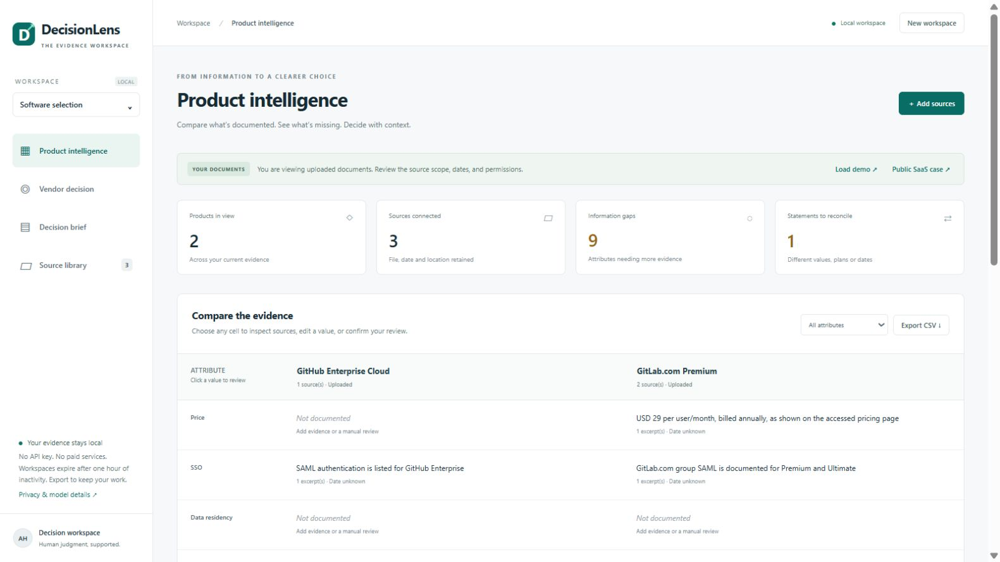

# DecisionLens

**Evidence before decisions.** A free, local product-comparison and vendor-decision workspace,
upgraded from Aditya Hambire's [RAG Chatbot](https://github.com/adityahaa/Rag_chatbot).
Upload documents, inspect the evidence behind each value, review gaps and differences,
set priorities, and export an editable decision brief. The user makes the final decision.



## Run locally on Windows

For a fresh GitHub clone, follow the setup section below first. After setup,
double-click **`Start-Here.cmd`**, or open PowerShell in this folder and run:

```powershell
powershell -NoProfile -ExecutionPolicy Bypass -File .\Start.ps1
```

Open **http://127.0.0.1:8765** in your browser. If the app is already running, open that URL
directly. Keep the terminal open; Ctrl+C stops it. If port 8765 is in use, use `Start.ps1 -Port 8766`.
Do **not** open `static/index.html` directly: file URLs cannot use the Python API.
The execution-policy option applies only to this process; it does not change system policy.

## Setup after moving the project / extracting the source ZIP

Install Python **3.11 (64 bit)** from python.org with the Windows `py` launcher. Extract the
ZIP, open PowerShell inside `DecisionLens`, then:

```powershell
powershell -NoProfile -ExecutionPolicy Bypass -File .\Setup.ps1
powershell -NoProfile -ExecutionPolicy Bypass -File .\Start.ps1
```

Setup installs the exact tested Windows environment in `.venv` and downloads the free local
MiniLM embedding model. Internet is needed for setup; allow roughly 1–2 GB of free disk space
for Python libraries and model files. There is no account, credit card, billing activation or
API key. The ZIP omits model binaries and the virtual environment; downloads are reused if
already present. To include the optional small generator, run setup with `-WithGenerator`.
**That generator failed the tested answerable questions; evidence search is the recommended default.**

Manual equivalent:

```powershell
py -3.11 -m venv .venv
.venv\Scripts\python.exe -m pip install -r requirements-lock.txt
.venv\Scripts\python.exe scripts\prepare_models.py
# Optional, experimental:
.venv\Scripts\python.exe scripts\prepare_models.py --generation
.venv\Scripts\python.exe -m uvicorn decisionlens.server:app --host 127.0.0.1 --port 8765 --no-access-log
```

## Try the workflow

1. Select **Load demo** for fictional Sprintly, ForgeFlow and OrbitDesk documents. Prices,
   terms and companies are synthetic. **Public SaaS case** instead loads short AI-assisted
   notes from linked official GitHub/GitLab pages; source publication dates remain unknown.
2. Or select **Add sources**. Upload one or more files for one product per batch. Use the
   same product name for additional documents about that product. Supply a source link and
   date when known. A blank product name uses the filename. Start a new workspace to replace
   the corpus. Duplicate identical uploads with the same metadata are ignored.
3. Inspect the comparison table. Select any cell to see literal excerpts and page/section,
   filename, URL, date and synthetic status. Edit and confirm with a review note. A missing
   cell is unknown; a differing-value flag requires scope/date/plan review.
4. Ask for evidence. Choose hybrid, semantic or keyword retrieval. Default responses show
   candidate excerpts. An optional local answer draft is experimental and may be wrong.
   After source changes, run the question again. No conversational memory is supplied.
5. Open **Vendor decision**. Edit requirements and positive weights, then assign your own
   0–100 ratings. Only confirmed cells with ratings count. Unknowns are excluded, not zero.
   Coverage is eligible weight / total weight. Partial scores can be misleading if coverage
   differs; the app declares no winner and performs no price/unit conversions.
6. Open **Decision brief**, edit the Markdown, save and export. Comparison CSV and evidence
   JSON are also available. Export before closing: workspaces expire after one hour of
   inactivity or server restart. Changes to evidence or priorities regenerate the brief.

Practical formats: **text PDF, UTF-8 TXT/MD/CSV/JSON, DOCX**. Up to 10 MB per file,
10 per upload batch, 20 per workspace; PDFs up to 200 pages. Scans need OCR outside the app.
DOCX page numbering is unavailable. JSON/CSV are converted to readable key/value records;
complex nested JSON or tables may require restructuring. Explicit lines such as
`SSO: SAML included` extract best. Arbitrary prose is searchable but is not reliably turned
into structured facts. Manually add missing values through review and state their origin.

## What was actually tested

- Windows / Python 3.11: pinned installation, local MiniLM and FLAN inference, API input
  through review, scoring, export and session isolation; see [verification](docs/VERIFICATION.md).
- A real in-app-browser walkthrough uploaded `data/demo/beacon-synthetic.pdf`, displayed
  page-1 evidence, reviewed a conflicting price, rated a criterion with 30% coverage,
  saved a brief, and downloaded CSV and Markdown. Screenshots and synthetic exported files
  are in `docs/`. Narrow responsive layout was inspected; the table scrolls horizontally.
- Streamlit companion retains `.venv\Scripts\python.exe -m streamlit run rag_streamlit.py
  --server.address 127.0.0.1 --browser.gatherUsageStats false` (use one line). It supports
  local upload, comparison, retrieval and export. Full review/scoring features are in the
  main dashboard. Its session demo is checked with Streamlit AppTest.
- **No cloud-provider or current Gemini API call was performed.** Original source and
  history are preserved in `legacy/`, original docs and the Git history bundle.
  [Baseline audit](docs/BASELINE_AUDIT.md) explains why local semantic retrieval is a proxy.

## Research: executed, bounded pilot

The [protocol](research/PROTOCOL.md) preceded held-out evaluation. Public sources were
audited for accessibility, schema, licenses, duplicate maps and label support.
[Data audit](research/DATA_AUDIT.md), [literature](research/LITERATURE.md),
[actual results and charts](research/RESULTS.md), and [working paper draft](research/PAPER_DRAFT.md)
are included. The draft is **not submission-ready**.

- AWS Product Comparison: downloaded full TSV; 20 development and 60 held-out attribute
  signatures selected from explicit per-product records. All methods scored 100% on the
  easy held-out literal task, which cannot establish superiority or procurement accuracy.
- RAG-Multi-Corpus: 37 fictional airline Markdown files; strict label checks admit 46/164
  subset questions, split into 15 dev and 31 held-out. Hybrid source Recall@3 is 30/31;
  semantic is 28/31. This is synthetic source retrieval, not SaaS comparison accuracy.
- Controlled fictional cases: 20 dev and 60 held-out condition cases. Diversity reduces
  available-evidence recall from 78.3% to 52.2%. Every method misses the full conflicting
  value set in 15/15 conflict cases at k=3. All results, including negatives, are saved.
- Eighteen local generator calls: zero exact matches on nine answerable prompts;
  the nine absent prompts return `unanswerable`. The frozen phrase checker misses that
  abstention word, a documented metric limitation. No independent human ratings exist.

Reproduce on an extracted package (internet for raw public data; local inference thereafter):

```powershell
.venv\Scripts\python.exe scripts\download_data.py
.venv\Scripts\python.exe research\prepare_data.py
.venv\Scripts\python.exe scripts\prepare_models.py --generation
.venv\Scripts\python.exe research\run_experiments.py --split eval --generation
.venv\Scripts\python.exe research\plot_results.py
.venv\Scripts\python.exe research\validate_results.py
.venv\Scripts\python.exe -m pytest -q
```

Runs create new folders, never overwrite earlier results. If inputs or methods change after
seeing held-out outcomes, use a newly frozen protocol and evaluation set. Runtime/cache timing
will vary. The original evaluation source snapshot is saved in its run folder; later application
UX fixes are not method tuning. Source binaries and raw datasets are not in the source ZIP.

## Privacy, limitations and deployment

Application runtime sends no document data to external services. Uploaded contents and edits
remain in the local server's memory. Setup downloads public packages/models; data scripts
download public corpora. No source link is automatically fetched. Logs do not print keys or
documents. Exports contain your chosen evidence; share them deliberately. The server is a
local prototype with expiring session cookies, request-origin checks and local host restriction.
It is **not authenticated shared hosting**. Before deployment, add authentication, encrypted
durable storage, resource quotas, worker isolation and appropriate source/retention controls.

Literal extraction misses prose and semantic equivalence. Conflicting strings may be
complementary claims. Citations show provenance, not proof of factual correctness. Retrieval
can miss relevant facts, and prompt injection/hallucination risks remain for generated drafts.
The study does not demonstrate independent human satisfaction, real-world savings, statistical
significance, novelty or publication readiness. No paper has been submitted.

## Attribution and checkpoints

Original maintained repository: Aditya Hambire's RAG Chatbot; original Git authorship retained.
No original project license was found, so this upgrade does not invent a license for prior
work. Dataset/library/model rights remain with their owners. AWS data: CC BY-SA 4.0,
Vedula et al.; RAG-Multi-Corpus: MIT, UDAY ALLU, synthetic; model cards and pinned revisions:
`models_manifest.json`. See [notices](licenses/NOTICES.md).
Progress and resumption instructions: [HANDOFF.md](HANDOFF.md).

The source ZIP includes `history/original-rag-chatbot.bundle`. To inspect the original
history in a separate folder, run `git clone history\original-rag-chatbot.bundle original-history`
from this project folder. The repository contains the DecisionLens upgrade and recorded pilot
results; no live website or hosted app is deployed. Rebuild a local source ZIP with
`python scripts\package_source.py`.
