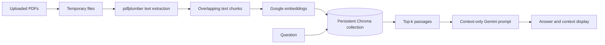

# Historical Gemini PDF pipeline

This guide records the earlier RAG Chatbot implementation reviewed before the DecisionLens upgrade. Its source is retained under `legacy/`. Commands and provider settings below describe that earlier checkout. Use the repository README for the current application setup and results.

# PDF Retrieval-Augmented Generation Chatbot

A Streamlit prototype for asking questions over uploaded PDFs using Gemini embeddings, Chroma similarity retrieval, and a Gemini chat model. The objective is to show the retrieved context beside answers so users can inspect the supporting text.


## Contents

[Implemented pipeline](#implemented-pipeline) · [Setup and execution](#setup-and-execution) · [Reproduction status](#reproduction-status) · [Limitations](#limitations) · [Attribution](#attribution) · [From a PDF to an inspectable answer](#from-a-pdf-to-an-inspectable-answer)

## Implemented pipeline

1. Extract text locally with `pdfplumber`.
2. Split it into approximately 1,000-character chunks with 200-character overlap.
3. Embed chunks through Google and persist them in Chroma.
4. Retrieve the top `k` similar chunks (default 3).
5. Send those chunks and the question to Gemini with a context-only answer instruction.
6. Display the response and retrieved context in Streamlit.

`rag_streamlit.py` owns the interface and session state; `session_4_rag_backend.py` implements extraction, indexing, retrieval, and generation. The code directly invokes a prompt and retriever; it does not use `ConversationalRetrievalChain`. Previous chat turns are displayed but are not passed as conversational memory to the generation call.

## Setup and execution

```powershell
git clone https://github.com/adityahaa/Rag_chatbot.git
cd Rag_chatbot
py -3.11 -m venv .venv
.venv\Scripts\python.exe -m pip install -r requirements.txt
.venv\Scripts\python.exe -m streamlit run rag_streamlit.py
```

Open the printed local URL, enter a Gemini key in the sidebar, select **Set API Key**, upload a text-based synthetic PDF, and select **Process Documents**. For a PDF containing `The sample project deadline is 15 May`, ask `What is the sample project deadline?` and inspect whether the retrieved context contains that statement. This is a manual check, not a recorded model result.

## Reproduction status

No public demo, labeled QA dataset, or retrieval/answer-quality benchmark is supplied. [Technical report](TECHNICAL_REPORT.md) documents verification and blockers. Dependencies are unpinned. The text splitter import now uses its dedicated langchain-text-splitters package; full dependency integration remains unverified. Default model IDs are `models/text-embedding-004` and `gemini-2.0-flash-thinking-exp-01-21`; successful current-provider calls have not been verified. Compatible packages, a valid key, and accessible model IDs are required before claiming an end-to-end run.

## Limitations

Scanned PDFs have no OCR path. File source metadata is assembled in the interface but not passed to the indexing function. Chroma uses a shared local persistence directory and API configuration uses a process-wide environment variable, so this prototype is unsuitable for shared multi-user hosting. Temporary-file cleanup is incomplete on failure paths. PDF text is sent to external embedding/generation services; use synthetic or approved public documents. A context-only prompt does not guarantee grounded answers or resistance to document prompt injection.

## Attribution

Maintained in Aditya Hambire's repository; existing Git history records contributions. Libraries and model services retain their respective rights. No publication or paper reproduction is claimed.

Current checks and unresolved prerequisites: [verification record](VERIFICATION.md).

## From a PDF to an inspectable answer

Document questions require locating relevant passages before composing a response. The application gives this task a visible workflow. The user processes a group of PDFs once, asks questions through the chat interface, and opens the source-context expander to inspect what the generator received.



### Indexing and retrieval details

`process_documents` writes each upload to a temporary PDF and calls `parse_pdf`, which concatenates extractable page text. `create_document_chunks` prefers paragraph, line and word boundaries before falling back to character boundaries. The overlap keeps some text available on both sides of a split, at the cost of indexing repeated material.

`store_embeddings` calls `Chroma.from_texts`, which generates and stores embeddings. The separate `embed_documents` helper is a connectivity probe and is not the bulk indexing stage in this UI. The retriever uses similarity search with the user-selected `k`, from 1 through 10. Increasing `k` supplies more context and can also admit less relevant passages.

### Prompt and interface behavior

`get_context_from_chunks` labels retrieved passages `[Chunk 1]`, `[Chunk 2]` and so forth. `query_with_full_context` joins them into a prompt instructing the model to answer from the context or abstain. Generation uses the supplied temperature, `top_p=0.95`, and a 1,024-token output limit. The interface stores question/answer pairs and context for display.

The implemented output is therefore an answer together with the exact retrieved text supplied to generation. The repository's reproducible evidence currently establishes syntax and the source-defined pipeline. A provider-backed answer-quality result requires accessible models and a labeled question set. The evaluation plan in the report proposes retrieval Recall@k, correctness and abstention checks on the same documents.

### File guide and next steps

| File | Role |
|---|---|
| `rag_streamlit.py` | Configuration, multi-file processing, chat and context display |
| `session_4_rag_backend.py` | PDF parsing, splitting, embedding, retrieval and generation |
| `requirements.txt` | Streamlit, Google/LangChain integration, Chroma and PDF dependencies |
| `docs/TECHNICAL_REPORT.md` | Evaluation design and interpretation |

Source/page metadata propagation, isolated collections and a frozen PDF QA set would make the next iteration easier to evaluate and operate. They directly address passage traceability, document separation and answer verification.
