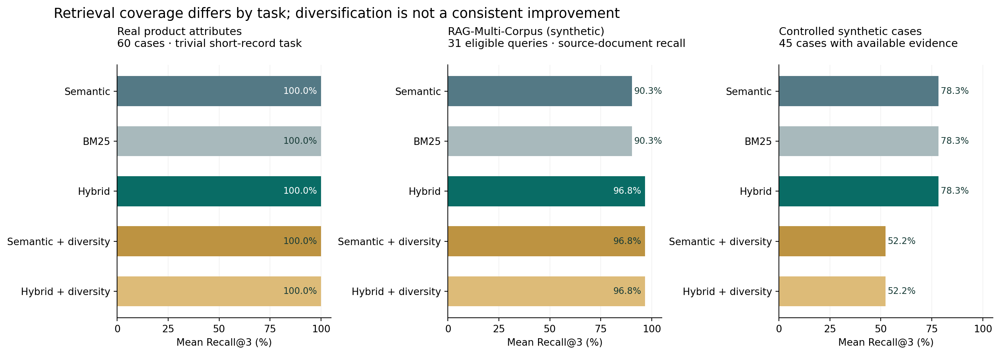
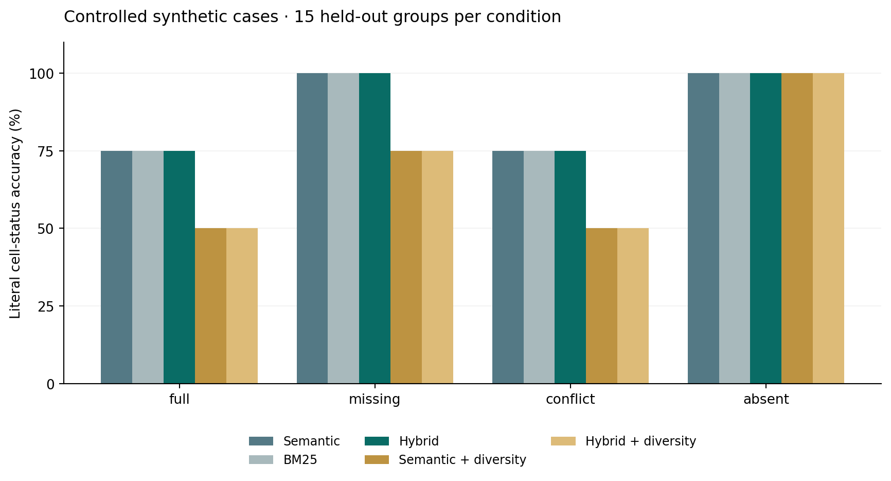

# Recorded pilot results

Final evaluation: `runs/20261104T204725_905751Z/` (local date 2026-11-05).
151 held-out cases × 5 retrieval methods = **755 successful method/case runs**, zero execution
failures. Separate development run: `20261104T071859_329995Z`, 55 cases × 5 = 275 runs.
Final run has **18 real local FLAN-T5 generation calls**, not mocked answers and not a cloud provider.
Settings, model revisions, per-case IDs, token counts and failures are saved alongside the summary.
Protocol was saved before evaluation; it was not externally preregistered. No model fine-tuning.

## Retrieval and literal recovery

| Method | Real attribute Recall@3, n=60 | Synthetic enterprise document Recall@3, n=31 | Controlled Recall@3, n=45 with evidence | Controlled literal cell accuracy, n=60 |
| --- | ---: | ---: | ---: | ---: |
| Semantic baseline proxy | 100.0% | 90.3% (28/31) | 78.3% | 87.5% |
| BM25 | 100.0% | 90.3% (28/31) | 78.3% | 87.5% |
| Hybrid | 100.0% | 96.8% (30/31) | 78.3% | 87.5% |
| Semantic + diversity | 100.0% | 96.8% (30/31) | 52.2% | 68.8% |
| Hybrid + diversity | 100.0% | 96.8% (30/31) | 52.2% | 68.8% |

Recall is a per-case macro mean. Evidence units differ across tasks (attribute snippets vs
source documents), so percentages are not interchangeable or pooled. Enterprise hit counts
equal recall here because all selected held-out queries have one gold source filename.
No statistical significance or general population improvement is claimed.

The real-source task is **uninformative for method superiority**: short one-attribute records,
at most three gold snippets, and irrelevant generic distractors fit the top-3 budget. These
100% results do not establish real-world comparison accuracy or reproduction of HCPC.

The paired diversity ablations help identify the limited mechanism. On the enterprise subset,
hybrid and diversity each improve the observed document hit count over dense retrieval by two;
their combination does not improve it further. On the controlled corpus, diversity consumes
a context slot on an unrelated vendor rather than retaining another needed fact from an
already represented vendor. Both diversity variants therefore reduce coverage. This is a
failure of this specific heuristic, not evidence against all diversity methods.

## Missing and conflicting information

Of the 60 controlled cases, 15 each are full, one-fact-missing, conflicting and absent.
Only 45 have any gold evidence. All methods identify absent values correctly under the
fixed literal schema: missing-status accuracy is 100% on 30 cases containing missing cells
(75 missing cells in total). This is a deterministic schema result, not a hallucination rate.
Known-cell recovery macro-averaged over 45 cases is 91.7% without diversity and 61.1% with it.

**Conflict recall is 0/15 for every method**: the retrieved top-3 contexts fail to include
both contradictory values. Plain/hybrid complete-evidence rate is 15/45; diversity is 0/45.
Full and conflict conditions require four or five snippets, so complete evidence is impossible
under k=3. This budget ceiling was specified in the protocol and is an important limitation.
The app's matrix extractor reads all loaded documents, unlike this retrieval-limited experiment;
it does flag the synthetic demo's differing prices. Do not confuse that UI behavior with
conflict recovery by a top-k answer pipeline.

## Small generator: a negative feasibility result

The same local `google/flan-t5-small` model, greedy settings and prompt were used on three
held-out fictional groups, full and absent conditions, for three retrieval methods (18 calls).
All **9 answerable outputs are citation-like strings** (`[2]` or `[3]`) rather than the reference
SSO value. Exact answer match is 0/9. All 9 absent outputs are the word `unanswerable`.
These outputs were observed directly by the AI coding collaborator, not independently rated
by people. They suggest lexical abstention on this tiny template, not broad safe behavior.

The frozen abstention phrase list omitted `unanswerable`, so its automatic abstention flag is
false even for those 9 outputs. That metric is a **measurement limitation**, not evidence the
model answered the absent cases. Raw outputs and the original check are retained; the classifier
was not changed and the held-out study was not rerun. No semantic-answer score is asserted.

## Latency and verification boundaries

On this Windows CPU, mean warm query retrieval was approximately 18–23 ms for methods using
MiniLM and 0.2–1.0 ms for BM25, varying by task. Encoder startup was about 15.1 seconds in the
final run. Per-case `index_ms` and generator token/latency fields are recorded. Timing is
sequential, single-machine and cache-dependent; it is not a production service guarantee.

An independent arithmetic script recomputed all 755 retrieval memberships and summary recall
denominators from saved IDs and checked zero dev/eval group overlap. It does not validate the
semantic adequacy of the supplied labels. Important application tests and browser checks are
reported separately in `docs/VERIFICATION.md`.

## Decision

Keep evidence retrieval and user-reviewed extraction as the app default. The optional small
generator is labelled experimental because it failed answerable pilot questions. Preserve the
negative diversification result; do not adopt it as an automatic app improvement. A new study
needs harder real multi-source product cases, more capable local models and independent labels.
